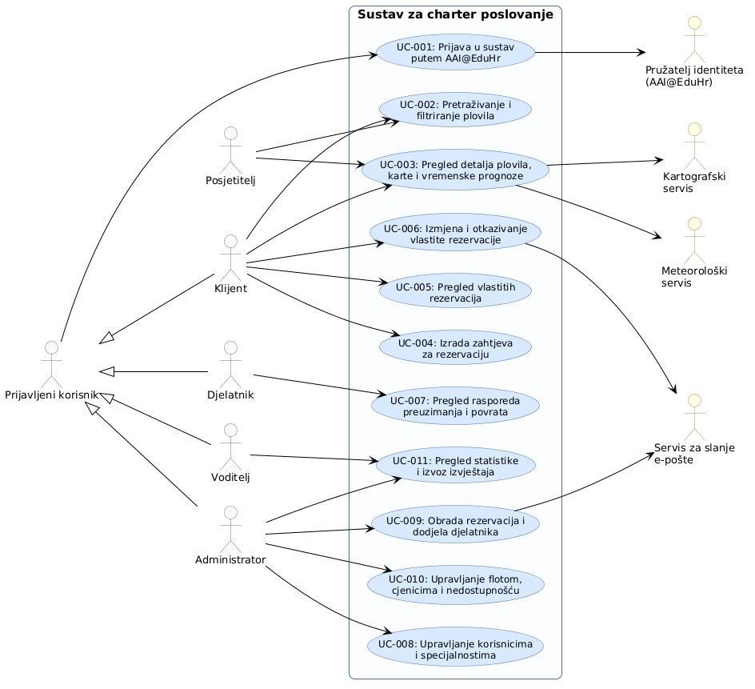

# 3. Obrasci uporabe

**Cilj:** Prikazati glavne interakcije između aktera aplikacije i sustava. Opisujemo kako akter ostvaruje cilj i što se događa kada važan korak ne uspije. Interakcije temeljimo na odobrenim zahtjevima i ažuriramo ih kako se aplikacija razvija.

## 3.1 Dijagram obrazaca uporabe

**Cilj:** Prikazati granicu sustava, relevantne aktere i njihove glavne ciljeve u preglednom UML dijagramu obrazaca uporabe.

**Slika 3.1. Dijagram obrazaca uporabe sustava za charter poslovanje**

**PlantUML izvor:** [izvor](./puml/charter-uml-diagram.puml)

**Provjera dijagrama:** Dijagram prikazuje primarne ljudske aktere (posjetitelj, klijent, djelatnik, voditelj charter tvrtke i administrator sustava) te sekundarne vanjske sustave (AAI@EduHr, meteorološki servis, kartografski servis i servis za slanje e-pošte). Koristi se generalizacija prijavljenih korisnika preko apstraktnog aktera *Prijavljeni korisnik* radi sažetog prikaza autentifikacije. Odabir dodatnih usluga i dodatne opreme čini sastavni korak obrasca izrade rezervacije, pa je izbjegnuto nepotrebno usložnjavanje dijagrama relacijama `<<extend>>` i `<<include>>`.

## 3.2 Specifikacije obrazaca uporabe

**Cilj:** Za svaki obrazac uporabe iz dijagrama objasniti cilj aktera, uobičajenu interakciju s aplikacijom i važne alternative.

### UC-001: Prijava u sustav putem AAI@EduHr

| Element specifikacije | Opis |
| :--- | :--- |
| **Primarni akter** | Prijavljeni korisnik (A-01 do A-05) |
| **Sekundarni akter** | AAI@EduHr pružatelj identiteta (A-06) |
| **Povezani zahtjevi** | C-01, NF-02, NF-05, NF-06, AS-11 |
| **Preduvjeti** | Korisnik posjeduje važeći AAI@EduHr elektronički identitet. |
| **Glavni uspješni tok** | 1. Korisnik odabire prijavu putem AAI@EduHr. 2. Aplikacija preusmjerava korisnika na središnje sučelje pružatelja identiteta. 3. Korisnik unosi pristupne podatke i potvrđuje prijenos identifikatora, imena, prezimena i adrese e-pošte. 4. Pružatelj identiteta autentificira korisnika i vraća ga u aplikaciju s OAuth 2.0 autorizacijskim kodom. 5. Sustav provjerava postojanje računa prema AAI@EduHr identifikatoru i e-pošti: &nbsp;&nbsp;&nbsp;a) ako račun postoji i aktivan je (`aktivan = TRUE`), dohvaća se dodijeljena uloga (i specijalnost ako je djelatnik); &nbsp;&nbsp;&nbsp;b) ako korisnik pristupa prvi put, sustav stvara novi račun s ulogom klijenta i postavlja ga u aktivno stanje. 6. Sustav uspostavlja zaštićenu sesiju i prilagođava korisničko sučelje pripadajućoj ulozi. |
| **Alternativni tokovi / Iznimke** | **3a — Neuspjela autentifikacija ili odustajanje:** Pružatelj identiteta odbija vjerodajnice ili korisnik prekida postupak; sesija se ne stvara, a korisnik ostaje neautentificirani posjetitelj. **5a — Deaktiviran račun:** Ako račun u bazi ima status `aktivan = FALSE`, sustav prekida prijavu, odbacuje tokene i prikazuje poruku o deaktivaciji računa. |
| **Posljedice (ishod)** | Korisnik je autentificiran bez pohrane lokalnih lozinki; aplikacija mu dodjeljuje radno okruženje ovisno o ulozi. |

### UC-002: Pretraživanje i filtriranje plovila

| Element specifikacije | Opis |
| :--- | :--- |
| **Primarni akter** | Posjetitelj (A-01) / Klijent (A-02) |
| **Povezani zahtjevi** | F-002, F-003, F-008, AS-02, AS-03, AS-10 |
| **Preduvjeti** | U bazi postoje aktivna plovila i definirane matične luke. |
| **Glavni uspješni tok** | 1. Korisnik otvara katalog plovila te zadaje kriterije: naziv, razdoblje najma (datum i vrijeme preuzimanja i povrata), matičnu luku, vrstu plovila i potreban kapacitet osoba. 2. Sustav provjerava valjanost unesenog razdoblja (`vrijemePreuzimanja >= sada` i `vrijemePovrata > vrijemePreuzimanja`). 3. Sustav izračunava broj dana najma prema pravilu AS-03 (zaokruživanje na 24-satna razdoblja naviše). 4. Sustav pronalazi plovila koja zadovoljavaju kriterije i koja u tablici zauzetosti nemaju preklapanja u traženom intervalu `[preuzimanje, povrat)`. 5. Za svako dostupno plovilo sustav prikazuje osnovne podatke i izračunatu cijenu najma za zadano razdoblje. 6. Prikazuje se filtrirani popis plovila. |
| **Alternativni tokovi / Iznimke** | **2a — Neispravno razdoblje:** Vrijeme preuzimanja je u prošlosti ili je povrat prije preuzimanja; sustav odbija pretragu uz poruku upozorenja. **4a — Nema rezultata:** Niti jedno plovilo ne zadovoljava zadane uvjete; sustav prikazuje obavijest o nepostojanju slobodnih plovila i predlaže izmjenu parametara. |
| **Posljedice (ishod)** | Korisnik ima uvid u slobodna plovila i točan izračun cijene osnovnog najma za odabrani termin. |

### UC-003: Pregled detalja plovila, lokacije i vremenske prognoze

| Element specifikacije | Opis |
| :--- | :--- |
| **Primarni akter** | Posjetitelj (A-01) / Klijent (A-02) / Djelatnik (A-03) |
| **Sekundarni akteri** | Meteorološki servis (A-07), Kartografski servis (A-08) |
| **Povezani zahtjevi** | F-002, F-004, F-005, F-006, C-02, C-03, NF-04, NF-06, AS-08 |
| **Preduvjeti** | Plovilo je evidentirano i aktivno u katalogu. |
| **Glavni uspješni tok** | 1. Korisnik odabire plovilo iz kataloga ili rezultata pretrage. 2. Sustav prikazuje tehničke detalje plovila, osnovnu opremu, galeriju fotografija (s označenom glavnom slikom) i cijenu po danu najma. 3. Sustav generira i prikazuje kalendar zauzetosti plovila (prikaz zauzetih i servisnih termina bez otkrivanja identiteta klijenata). 4. Sustav šalje koordinate matične luke kartografskom servisu i prikazuje interaktivnu kartu mjesta preuzimanja. 5. Sustav šalje upit meteorološkom servisu za odabrano razdoblje i lokaciju te prikazuje podatke o temperaturi, vjetru i vremenskim uvjetima. |
| **Alternativni tokovi / Iznimke** | **4a — Kartografski servis nedostupan:** Prikazuje se tekstualna obavijest o nedostupnosti karte; ostali podaci ostaju dostupni. **5a — Meteorološki servis nedostupan ili izvan dometa:** Prikazuje se obavijest o nedostupnosti prognoze za traženi termin, a stranica nastavlja s radom. |
| **Posljedice (ishod)** | Korisnik raspolaže potpunim informacijama o plovilu, lokaciji matične baze i meteorološkim uvjetima. |

### UC-004: Izrada zahtjeva za rezervaciju

| Element specifikacije | Opis |
| :--- | :--- |
| **Primarni akter** | Klijent (A-02) |
| **Povezani zahtjevi** | F-007, F-008, F-009, NF-03, AS-01, AS-02, AS-03, AS-05, AS-06 |
| **Preduvjeti** | Korisnik je prijavljen s ulogom klijenta i odabrao je raspoloživo plovilo. |
| **Glavni uspješni tok** | 1. Klijent unosi datum i vrijeme preuzimanja i povrata te broj osoba. 2. Sustav provjerava ispravnost intervala i provjerava da broj osoba ne premašuje kapacitet plovila. 3. Klijent po želji odabire dodatne usluge (jednokratna naknada) i dodatnu opremu uz odabir količine (naplata po danu najma). 4. Sustav izračunava i prikazuje specifikaciju ukupnog iznosa: `(dnevnaCijena × brojDanaNajma) + zbroj(cijenaOpreme × količina × brojDanaNajma) + zbroj(cijenaUsluge × količina)`. 5. Klijent potvrđuje slanje zahtjeva. 6. Sustav unutar bazične transakcije ponovno provjerava raspoloživost termina `[preuzimanje, povrat)` kako bi spriječio preklapanje. 7. Sustav zauzima termin u tablici `TERMIN` i sprema rezervaciju u tablicu `REZERVACIJA` sa statusom „zahtjev za rezervaciju” te pohranjuje ugovorene cijene stavki. 8. Klijentu se prikazuje potvrda o zaprimljenom zahtjevu. |
| **Alternativni tokovi / Iznimke** | **2a — Prekoračen kapacitet plovila ili neispravno vrijeme:** Sustav onemogućuje slanje zahtjeva i označava neispravna polja. **6a — Istodobno zauzeće termina:** Drugi korisnik je potvrdio rezervaciju za isti termin; transakcija se prekida, a klijent dobiva obavijest da je plovilo u međuvremenu zauzeto. |
| **Posljedice (ishod)** | Zahtjev za rezervaciju je evidentiran u bazi, termin je označen kao zauzet, a status rezervacije čeka administratorsku obradu. |

### UC-005: Pregled vlastitih rezervacija

| Element specifikacije | Opis |
| :--- | :--- |
| **Primarni akter** | Klijent (A-02) |
| **Povezani zahtjevi** | F-010, NF-02, NF-06 |
| **Preduvjeti** | Klijent je prijavljen u sustav. |
| **Glavni uspješni tok** | 1. Klijent otvara modul vlastitih rezervacija. 2. Sustav prikazuje sve njegove rezervacije s podacima: naziv plovila, razdoblje najma, status („zahtjev za rezervaciju”, „potvrđena”, „otkazana”, „završeni najam”), popis odabranih usluga i opreme te ukupni iznos. 3. Ako je rezervacija u statusu „potvrđena”, a vrijeme povrata je proteklo, sustav je prikazuje kao „završeni najam” (AS-13). 4. Klijent može odabrati pojedinu rezervaciju radi izmjene ili otkazivanja (UC-006). |
| **Alternativni tokovi / Iznimke** | **2a — Nema evidentiranih rezervacija:** Sustav prikazuje prazan popis uz poruku da klijent nema aktivnih rezervacija. **2b — Pokušaj pristupa tuđoj rezervaciji:** Sustav odbija neovlašteni pristup i bilježi sigurnosno upozorenje. |
| **Posljedice (ishod)** | Klijent ima cjelovit i zaštićen uvid u status i troškove svih svojih rezervacija. |

### UC-006: Izmjena i otkazivanje vlastite rezervacije

| Element specifikacije | Opis |
| :--- | :--- |
| **Primarni akter** | Klijent (A-02) |
| **Sekundarni akter** | Servis za slanje e-pošte (A-09) |
| **Povezani zahtjevi** | F-009, F-011, F-012, NF-04, AS-07 |
| **Preduvjeti** | Klijent je prijavljen i posjeduje rezervaciju koja još nije započela. |
| **Glavni uspješni tok (Izmjena)** | 1. Klijent odabire rezervaciju koja je u statusu „zahtjev za rezervaciju” i pokreće izmjenu. 2. Klijent mijenja razdoblje najma, broj osoba ili odabrane dodatne usluge/opremu. 3. Sustav provjerava raspoloživost novog termina i kapacitet te ponovno izračunava ukupni iznos. 4. Klijent potvrđuje izmjenu; sustav ažurira rezervaciju u bazi. |
| **Glavni uspješni tok (Otkazivanje)** | 1. Klijent odabire rezervaciju u statusu „zahtjev za rezervaciju” ili „potvrđena” i pokreće otkazivanje. 2. Klijent potvrđuje namjeru otkazivanja. 3. Sustav postavlja status rezervacije na „otkazana” i oslobađa pripadajući termin plovila. 4. Sustav putem servisa e-pošte klijentu šalje obavijest o otkazivanju (F-012). |
| **Alternativni tokovi / Iznimke** | **1a — Pokušaj izmjene potvrđene rezervacije:** Sustav obavještava klijenta da se potvrđena rezervacija ne može izravno mijenjati te ga upućuje na otkazivanje i izradu novog zahtjeva (AS-07). **1b — Pokušaj otkazivanja nakon početka najma:** Datum i vrijeme preuzimanja su nastupili; sustav odbija otkazivanje. **4a — Neuspjelo slanje e-pošte:** Otkazivanje ostaje evidentirano u bazi, a neuspjeh slanja poruke se bilježi bez prekida toka (NF-04). |
| **Posljedice (ishod)** | Zahtjev je izmijenjen ili je rezervacija otkazana, pri čemu se termin plovila oslobađa za druge korisnike bez naplate naknade. |

### UC-007: Pregled rasporeda preuzimanja i povrata plovila

| Element specifikacije | Opis |
| :--- | :--- |
| **Primarni akter** | Djelatnik charter tvrtke (A-03) |
| **Povezani zahtjevi** | F-013, NF-06, AS-13 |
| **Preduvjeti** | Djelatnik je prijavljen u sustav sa svojom ulogom. |
| **Glavni uspješni tok** | 1. Djelatnik otvara operativni raspored preuzimanja i povrata plovila. 2. Djelatnik filtrira prikaz po odabranom danu ili razdoblju. 3. Sustav prikazuje popis potvrđenih rezervacija s podacima o plovilu, klijentu (ime, prezime, kontakt e-pošta), točnom vremenu preuzimanja i povrata, matičnoj luci te odabranim uslugama i opremi. 4. Djelatnik koristi podatke za pripremu plovila i operativnu koordinaciju u marini. |
| **Alternativni tokovi / Iznimke** | **3a — Nema planiranih primopredaja:** Za odabrani dan nema potvrđenih rezervacija; sustav prikazuje informaciju o praznom rasporedu. |
| **Posljedice (ishod)** | Djelatnik ima pravodoban uvid u operativne zadatke i raspored kretanja plovila u bazi. |

### UC-008: Upravljanje korisničkim računima i specijalnostima

| Element specifikacije | Opis |
| :--- | :--- |
| **Primarni akter** | Administrator sustava (A-05) |
| **Povezani zahtjevi** | F-001, NF-02, AS-11 |
| **Preduvjeti** | Administrator je prijavljen u sustav. |
| **Glavni uspješni tok** | 1. Administrator otvara modul za upravljanje korisničkim računima. 2. Sustav prikazuje popis korisnika (ime, prezime, e-pošta, uloga, specijalnost, status aktivnosti). 3. Administrator odabire korisnika i mijenja mu ulogu (klijent, djelatnik, voditelj, administrator). 4. Ako je odabrana uloga „djelatnik”, administrator obavezno odabire njegovu specijalnost (skiper, mehaničar, kuhar, čistač i sl.). 5. Za uloge koje nisu djelatnik, sustav onemogućuje odabir specijalnosti. 6. Administrator može aktivirati ili deaktivirati račun korisnika. 7. Administrator potvrđuje izmjene; sustav ažurira podatke u bazi. |
| **Alternativni tokovi / Iznimke** | **4a — Djelatniku nije dodijeljena specijalnost:** Sustav odbija spremanje promjene uz poruku da je specijalnost obavezna za djelatnike. **6a — Deaktivacija zadnjeg aktivnog administratora:** Sustav provjerava ukupan broj aktivnih administratora i odbija deaktivaciju ili promjenu uloge ako se radi o jedinom preostalom administratoru. |
| **Posljedice (ishod)** | Korisnički račun ima ažurirana prava i ulogu, što izravno određuje njegove mogućnosti pri sljedećem zahtjevu prema poslužitelju. |

### UC-009: Obrada rezervacija i dodjela djelatnika

| Element specifikacije | Opis |
| :--- | :--- |
| **Primarni akter** | Administrator sustava (A-05) |
| **Sekundarni akter** | Servis za slanje e-pošte (A-09) |
| **Povezani zahtjevi** | F-009, F-012, F-014, F-017, C-04, NF-04, AS-01, AS-14 |
| **Preduvjeti** | Administrator je prijavljen; u sustavu postoje rezervacije za obradu. |
| **Glavni uspješni tok** | 1. Administrator otvara pregled rezervacija, primjenjuje filtre i odabire zahtjev za rezervaciju. 2. Administrator po potrebi rezervaciji dodjeljuje djelatnike (odabir aktivnih korisnika s ulogom djelatnika). 3. Sustav provjerava pokrivenost specijalnosti (npr. usluga skipera) i provjerava preklapanje djelatnika s drugim rezervacijama; ako postoje nepravilnosti, prikazuje informativna upozorenja. 4. Administrator odabire akciju „Potvrdi rezervaciju”. 5. Sustav mijenja status rezervacije u „potvrđena”. 6. Sustav putem servisa e-pošte klijentu šalje potvrdu rezervacije s podacima o plovilu, razdoblju, uslugama, iznosu i mjestu preuzimanja. 7. Sustav bilježi slanje obavijesti (`poslanaObavijest = TRUE`). |
| **Alternativni tokovi / Iznimke** | **4a — Administrator odbija zahtjev:** Administrator odabire odbijanje; sustav postavlja status na „otkazana”, oslobađa termin plovila i šalje klijentu obavijest o odbijanju. **4b — Otkazivanje ranije potvrđene rezervacije:** Administrator otkazuje potvrđenu rezervaciju prije početka najma; status prelazi u „otkazana”, a termin se oslobađa. **6a — Neuspjelo slanje potvrdne e-pošte:** Status rezervacije ostaje „potvrđena”, u bazi se bilježi neuspjeh slanja, a administrator dobiva upozorenje o potrebi provjere servisa (NF-04). |
| **Posljedice (ishod)** | Rezervacija je potvrđena (ili otkazana), djelatnici su pridruženi najmu, a klijentu je isporučena obavijest e-poštom. |

### UC-010: Upravljanje flotom, cjenicima i razdobljima nedostupnosti

| Element specifikacije | Opis |
| :--- | :--- |
| **Primarni akter** | Administrator sustava (A-05) |
| **Povezani zahtjevi** | F-008, F-015, F-016, F-018, AS-05 |
| **Preduvjeti** | Administrator je prijavljen u sustav. |
| **Glavni uspješni tok** | 1. Administrator odabire operaciju nad resursima: plovila, matične luke, vrste plovila, oprema, fotografije, cijene ili razdoblja nedostupnosti. 2. Pri unosu/uređivanju plovila zadaju se karakteristike, matična luka, dnevna cijena, osnovna oprema i fotografije (određuje se najviše jedna glavna slika). 3. Pri unosu usluga i dodatne opreme definiraju se nazivi i cijene (usluge jednokratno, oprema po danu najma). 4. Pri evidenciji nedostupnosti plovila administrator unosi razdoblje i razlog (servis, kvar, održavanje). 5. Sustav provjerava preklapa li se razdoblje nedostupnosti s postojećim rezervacijama u statusu „zahtjev” ili „potvrđena”. 6. Sustav sprema promjene; podaci postaju vidljivi u katalogu, a plovilo u servisu nedostupno za rezervacije. |
| **Alternativni tokovi / Iznimke** | **2a — Pokušaj trajnog brisanja plovila s rezervacijama:** Sustav odbija brisanje i omogućuje isključivo deaktivaciju plovila (F-015). **5a — Preklapanje nedostupnosti s postojećom rezervacijom:** Sustav odbija unos nedostupnosti uz obavijest o konfliktu dok se rezervacija ne otkaže (F-018). |
| **Posljedice (ishod)** | Flota, cjenici i termini servisa ažurirani su u bazi podataka bez utjecaja na iznose već sklopljenih rezervacija. |

### UC-011: Pregled statistike poslovanja i izvoz izvještaja

| Element specifikacije | Opis |
| :--- | :--- |
| **Primarni akter** | Voditelj charter tvrtke (A-04) / Administrator (A-05) |
| **Povezani zahtjevi** | F-019, C-05, AS-09 |
| **Preduvjeti** | Korisnik je prijavljen s ulogom voditelja ili administratora. |
| **Glavni uspješni tok** | 1. Korisnik odabire željeno razdoblje za analizu poslovanja. 2. Sustav dohvaća sve rezervacije u statusima „potvrđena” i „završeni najam”. 3. Sustav izračunava statističke pokazatelje prema AS-09: ukupan broj rezervacija, stopu zauzetosti plovila (udio sati), zbroj ugovorenih iznosa (uz zaseban prikaz iznosa završenih najmova) te rang-listu najtraženijih vrsta plovila i dodatnih usluga. 4. Aplikacija prikazuje izvještaj na zaslonu u tabličnom i grafičkom obliku. 5. Korisnik pokreće akciju izvoza u CSV. 6. Sustav generira standardnu CSV datoteku i započinje preuzimanje. |
| **Alternativni tokovi / Iznimke** | **2a — Nema evidentiranih rezervacija za zadano razdoblje:** Sustav prikazuje nulte vrijednosti u izvještaju te omogućuje izvoz pripremljene CSV datoteke sa zaglavljima. |
| **Posljedice (ishod)** | Korisnik ima uvid u ključne poslovne pokazatelje i raspolaže lokalnom CSV datotekom pogodnom za daljnju analizu. |

## 3.3 Provjera dosljednosti obrazaca uporabe

**Cilj:** Provjeriti međusobnu usklađenost obrazaca uporabe, aktera, zahtjeva i ispitnih slučajeva. Cjelovito mapiranje održava se isključivo u matrici sljedivosti zahtjeva.

| Provjera | Pitanje za tim | Nalaz i usklađenost |
| :--- | :--- | :--- |
| **Zahtjev** | Je li svaki važan obrazac uporabe povezan s postojećim zahtjevom? | Svih 19 funkcijskih zahtjeva (F-001 do F-019) izravno je pokriveno kroz 11 cjelovitih specifikacija obrazaca uporabe. Uvedeni su i specifični zahtjevi dodjele osoblja (F-014) i automatskog završetka najma (AS-13). |
| **Akter** | Odgovara li akter naveden ovdje prethodno utvrđenoj ulozi i dopuštenoj interakciji? | Akteri u potpunosti odgovaraju dionicima iz odjeljka 2.3. Djelatnik posjeduje specijalnost, prijava se provodi isključivo kroz AAI@EduHr (C-01), a vanjski servisi djeluju kao sekundarni akteri. |
| **Aplikacija** | Može li tim demonstrirati opisani glavni rezultat i važnu alternativu ili je opis jasno označen kao trenutačno oblikovanje? | Svi tokovi i alternative (npr. sprječavanje preklapanja, prekid slanja e-pošte bez rušenja transakcije, kontrola zadnjeg administratora) izravno su provjerljivi kroz planirane testne slučajeve. |